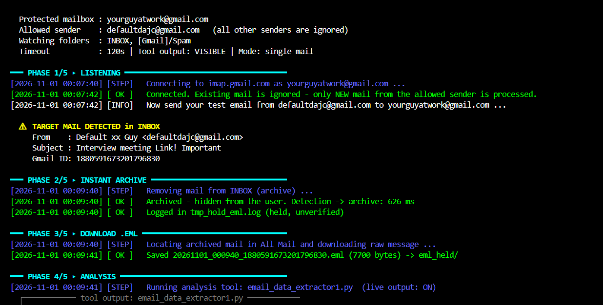
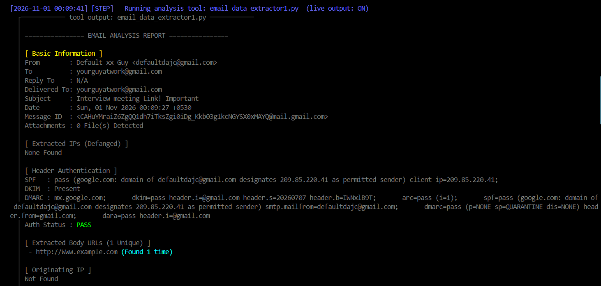
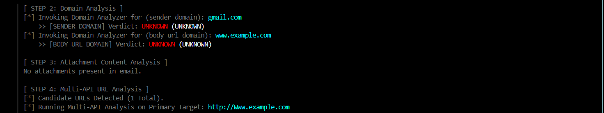
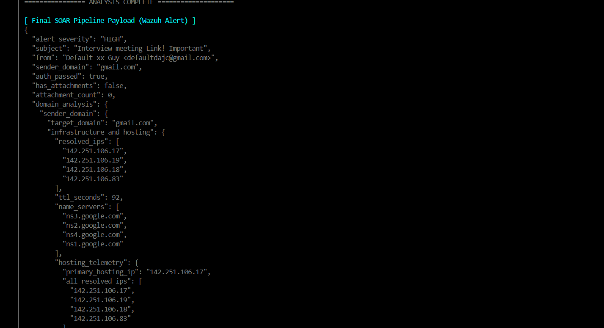
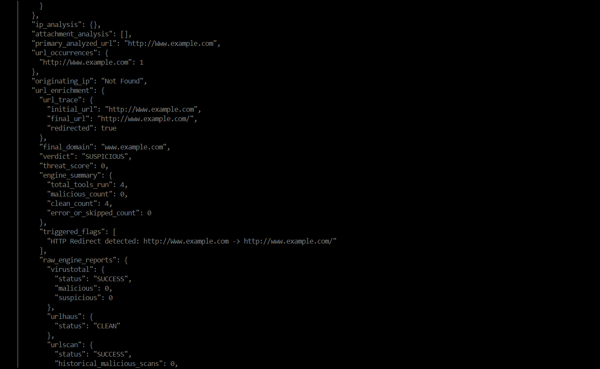
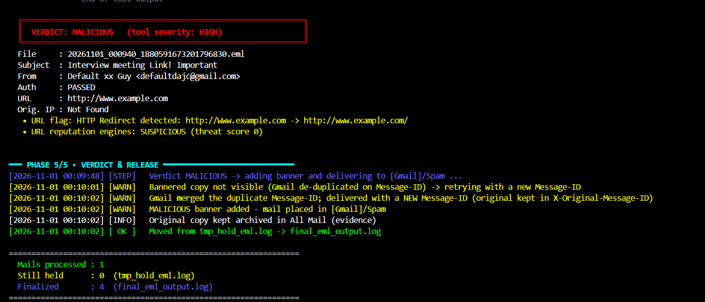
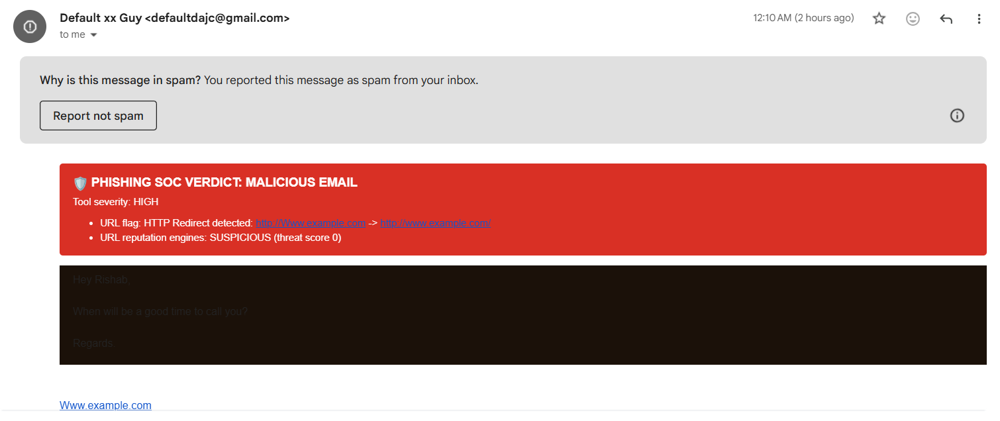

# KingPhisher-Man SOC Lab for Terminal


# KingPhisher-Man SOC Lab for Windows

A Windows-focused phishing detection and email analysis lab that simulates phishing email delivery, performs automated email security analysis, and supports SOC-style investigation and response workflows.

## Project Overview

KingPhisher-Man combines .eml collection, email analysis, inbox monitoring, and verdict-based email handling into a practical phishing analysis workflow. The project aims to demonstrate how suspicious emails can be analyzed, classified, and handled before they become a user-facing threat.

The lab currently supports two primary workflows:

- **Sample-based analysis:** Select phishing email samples from the Phishing Pot GitHub repository, analyze them, and deliver them to a Gmail inbox for controlled testing.
- **Live inbox monitoring:** Monitor a controlled Gmail inbox for incoming emails from a designated attacker account, analyze received messages, and handle them according to the analysis verdict.

## Getting Started - Terminal Based Version

1. Download the Repository

Install Python 3 and Git on Windows, then open PowerShell, Command Prompt, or the VS Code integrated terminal:

```
git clone https://github.com/rishi-blueteam/The-KingPhisher-Man.git
cd The-KingPhisher-Man
```
You can alternatively download the repository ZIP from GitHub and extract it locally.

2. Prepare the Python environment

The analysis pipeline uses external enrichment tools and may require third-party Python packages. Check the imports and setup instructions in the analyzer scripts before execution. If the repository provides a requirements.txt file, install it from the directory containing that file:

```
python -m pip install -r requirements.txt

```


3. Configure your own API Keys

The repository does not include personal API keys. Before using any API-dependent analysis module, inspect its configuration and supply credentials for the threat intelligence providers you choose to enable. Providers may have separate free-tier limits, registration requirements, and API permissions.

- Check the relevant Domain, URL, IP, and Attachment analysis scripts for their actual configuration variable names and supported services.

- Follow the environment-variable or local configuration method required by each script. Do not assume every module reads a .env file.

- Never commit API keys, Gmail App Passwords, or other secrets to GitHub.

- A missing or rate-limited API may cause an enrichment check to fail or return incomplete results; do not treat that as a clean verdict.

The api.key.env is added for a referencce of what all api keys you would be needing.


4. Run the Email Analysis

From the repository root (where email_data_extractor1.1_Tool_Github.py is located), supply the path to an .eml file:

```
python email_data_extractor1.1_Tool_Github.py "C:\path\to\suspicious_email.eml"
```

5. Review the findings

The pipeline extracts email indicators and produces structured analysis findings and a correlated verdict, subject to the enrichment services configured and available. Review the evidence from each analysis area rather than relying only on the final classification.


## Terminal Based SOC Workflow

```
[ Incoming Personalized Email / .eml Injection ] ➔ ➔ ➔ [ Enters @gmail.com Inbox ]
                                                   │
                                                   ▼ (Triggered Instantly)
                                         [ GMAIL API EVENT LISTENER ]
                                                   │
 ┌─────────────────────────────────────────────────┴─────────────────────────────────────────────────┐
 ▼ (Step 1: Immediate Quarantine Simulation)                                                          ▼ (Step 2: Analysis)
[ Remove 'INBOX' Label ] ➔ [ Apply 'TEMPORARY_HOLD' Label ]                                   [ Download Message Data as .eml String ]
              │
                                                                                                     ▼
                                                                                              [ RUN CODE ANALYSIS CHAIN ]
                                                                                                     │
 ┌───────────────────────────────────────────────────────────────────────────────────────────────────┴──────────────────────────────────┐
 ▼ IF VERDICT = CLEAN (Step 3A)                                                                                                         ▼ IF VERDICT = MALICIOUS (Step 3B)
1. Inject HTML Verdict Banner to Email Body String.                                                                                    1. Apply 'QUARANTINE' / Trash Label.
2. Send updated email copy back to Inbox via SMTP/API.                                                                                 2. Permanently delete/archive the original message.
3. Trash/Delete the original un-analyzed email from 'TEMPORARY_HOLD'.                                                                   3. Alert admin/console of blocked thread.
```


### 1. Email Sample Collection and Delivery

- The documented terminal sample-collection workflow selects five random .eml samples from the configured GitHub phishing sample source (distinct from the web UI Rookie mode, which retrieves one sample per run).
- Sends the selected messages to the configured Gmail inbox.
- Preserves the original email content and metadata while adding the configured recipient to BCC for controlled delivery.

### 2. Automated Email Analysis

The email analyzer extracts and evaluates relevant email indicators, including:

- **Header analysis:** Sender, recipient, Reply-To, subject, delivery details, attachments, authentication results, and originating IP information.
- **Domain analysis:** Evaluates domains using configured tools and heuristic rules.
- **URL analysis:** Supports investigation of suspicious links and associated indicators.
- **Attachment analysis:** Performs basic file analysis, including hash collection and reputation checks where configured.
- **IP analysis:** Extracts and examines relevant IP address indicators.

The analysis chain produces a JSON verdict containing correlated findings and scoring information. The output is intended to support downstream alerting and investigation.


### 3. Controlled Inbox Monitoring and Email Handling

The lab monitors a controlled Gmail inbox for new messages from a designated attacker account.

When a message is detected:

1. The message is temporarily removed from the inbox view and placed under a temporary hold label.
2. The message is downloaded and passed through the email analysis chain.
3. A verdict banner is added to the email copy.
4. The message is handled according to the verdict:
   - **Clean:** The updated message is returned to the inbox and the original is removed from temporary hold.
   - **Malicious:** The message is quarantined or moved to trash, and an administrative alert is generated.









The controlled attacker workflow currently uses a limited monitoring window to avoid indefinite polling.



### Current Version

**Version:** 2
**Phase-Number** 1  
**Status:** Completed

Updated URL Analysis, Header Analysis, Attachment Analysis, IP Analysis Lookup

## Known Limitations and Planned Work

- Elastic dashboard integration of the JSON verdict is not yet fully tested. Testing soon to be deployed
- Attachment analysis currently covers basic analysis; deeper sandbox-based behavioral analysis remains future work.
- URL, and IP analysis may be expanded as additional correlation rules and enrichment sources are implemented.
- Inbox monitoring and email handling may be further refined as the lab evolves.

## Repository Structure and Documentation

- [Main repository README](../README.md) - high-level project overview and previews of both interfaces.
- [Web UI README](../Windows%20Phishing%20SOC%20Simulation/README.md) -  browser-based Rookie, Amateur, and Pro workflows.

- This README - terminal-based usage and documented analysis workflows.
