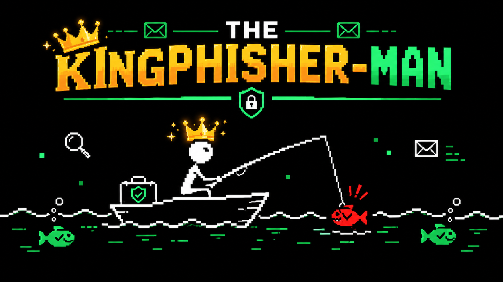

# KingPhisher-Man SOC Lab for Windows

Phishing Email Investigation | Threat Intelligence Correlation | SOC Simulation 

A Windows-focused, Python-based phishing analysis project with terminal and locally hosted web interfaces.


## Project Overview

The KingPhisher-Man is a hands-on phishing investigation and SOC simulation project built around the analysis of .eml email files. It extracts and examines email headers, domains, URLs, IP addresses, and attachments; enriches available indicators with threat intelligence; and produces correlated findings to support an analyst's investigation.

The project also includes controlled phishing-sample collection and Gmail monitoring workflows to explore how suspicious messages can be investigated and handled in a test environment.

The repository offers two interfaces that use the underlying Python analysis pipeline. The documentation for each is maintained separately so this page can serve as a quick project introduction.


## Watch the Web Interface in Action


Demo: the locally hosted web interface, from selecting an investigation mode to reviewing the analysis results. The GIF illustrates the interface; the application itself runs locally on the user's machine.

## Choose Your Interface


1. Web-Based Implementation
Use the locally hosted browser interface to investigate emails through three interactive modes:

|   Mode  |     Name     |                                              Purpose                                             |
|:-------:|:------------:|:------------------------------------------------------------------------------------------------:|
| Rookie  | The Shallows | Fetch and analyze a phishing email sample from the configured sample repository.                 |
| Amateur | Open Water   | Upload and analyze your own .eml file (up to 10 MB).                                             |
| Pro     | The Deep Sea | Monitor a controlled Gmail inbox for a designated test sender and investigate matching messages. |


The UI organizes results into H·D·I·F — Header, Domain, IP, and File analysis, alongside a combined risk assessment and report views. The current configuration imposes a unlimited number of runs per mode; operational cooldowns and external service limits still apply.

[Read the Web-Based README](./Windows%20Phishing%20SOC%20Simulation/README.md) - interface walkthrough, installation, three modes, Gmail configuration, and operational limitations.


2. Terminal-Based Implementation

Run the Python analysis scripts from a terminal to inspect .eml messages and explore the individual analysis components. The terminal implementation also includes scripts for sample collection, controlled email delivery, and Gmail monitoring.

What you can explore:
- Email header and authentication information
- Domain, URL, and IP indicator analysis
- Attachment inspection and hash-based reputation lookups
- Correlated results and structured investigation output
- Controlled sample-delivery and mailbox-handling workflows


### Analysis at a Glance

| Investigation area |                                                                     Focus                                                                    |   |
|:------------------:|:--------------------------------------------------------------------------------------------------------------------------------------------:|:-:|
| Email headers      | Sender and reply information, routing headers, SPF/DKIM/DMARC evidence, and originating IP indicators                                        |   |
| Domains            | Domain structure, registration and DNS context, certificate details, and heuristic risk indicators                                           |   |
| URLs               | Passive reputation checks through configured threat intelligence sources; no direct browsing of submitted URLs by the URL analyzer           |   |
| IP addresses       | Registration/ASN context, reverse DNS, reputation, and supporting infrastructure indicators                                                  |   |
| Attachments        | File hashes, reputation lookups, PDF content inspection, and optional image OCR                                                              |   |
| Correlation        | Combines available findings into an investigation-oriented assessment; missing or unavailable intelligence is not treated as proof of safety |   |


## Quick Start

Prerequisites: Python 3, Git (or a downloaded repository ZIP), an internet connection for online lookups, and your own credentials for API-based services you enable. Image OCR also requires the separately installed Tesseract executable.

```
git clone https://github.com/rishi-blueteam/The-KingPhisher-Man.git
cd The-KingPhisher-Man
python -m pip install -r requirements.txt

```

**Launch the Web Interface**

```
cd "Windows Phishing SOC Simulation"
python kingphisher_ui_2.py --check
python kingphisher_ui_2.py
```


The local server normally starts at http://127.0.0.1:8765/ and may select another port if needed. Press Ctrl+C to stop it.

Terminal Analysis

```
python email_data_extractor1.1_Tool_Github.py "path/to/sample.eml"
```


For full setup—including each analyzer's api_keys.env configuration and the Gmail test-account requirements—follow the implementation READMEs linked above.

|                                Document                               |                                   Contents                                  |   |
|:---------------------------------------------------------------------:|:---------------------------------------------------------------------------:|:-:|
| [Terminal-Based README](./Main%20Code%20Files/README.md)              | Python analysis workflow, CLI usage, component details, and configuration   |   |
| [Web-Based README](./Windows%20Phishing%20SOC%20Simulation/README.md) | UI walkthrough, Rookie/Amateur/Pro modes, installation, and local operation |   |
| [Python requirements](./requirements.txt)                             | Shared analysis-pipeline dependencies                                       |   |
|                                                                       |                                       


### Scope and Safety

This project is intended for cybersecurity learning, controlled testing, and SOC investigation practice. Use email samples and accounts you own or are authorized to investigate. The web interface binds to localhost rather than providing a public hosted service. Some external intelligence services require personal API credentials and enforce independent quotas.

A correlated verdict is an aid to investigation, not a guarantee that a message is safe or malicious. Gmail workflows can move or replace messages; use a dedicated test mailbox and review the detailed documentation before enabling monitoring.