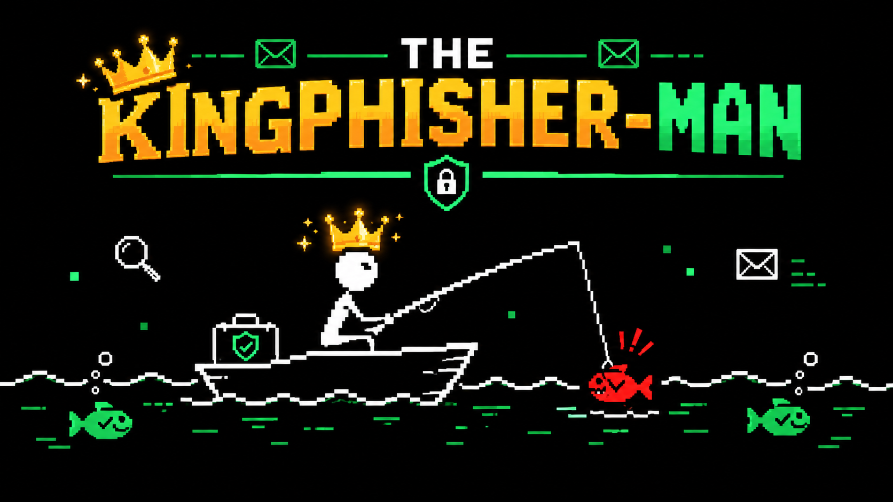
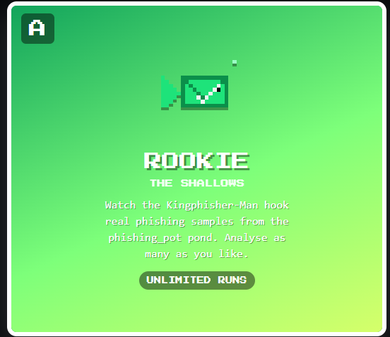
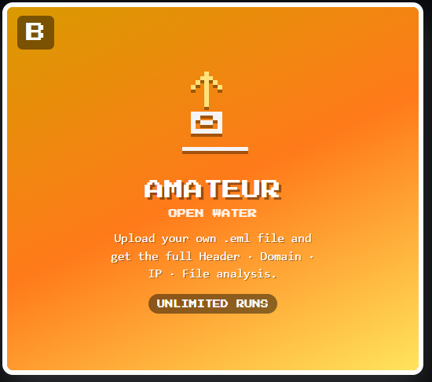
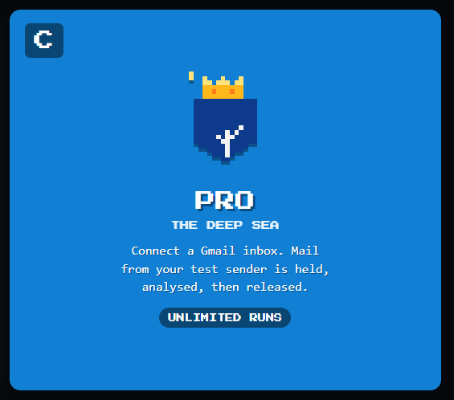

# KingPhisher-Man SOC Lab for Windows

A locally hosted browser interface for the KingPhisher-Man email analysis pipeline. It offers three interactive workflows—Rookie, Amateur, and Pro—with progress messages, correlated findings, and downloadable investigation reports.
Documentation scope: This README covers the web-based implementation in Windows Phishing SOC Simulation/. For the terminal-based analysis scripts and their full workflow, see [Terminal-Based Documentation](../Main%20Code%20Files/README.md). For the overall project, see the [repository README](../README.md).


## Project Overview

The UI is a local Python HTTP server, with HTML/CSS/JavaScript frontend files. It invokes the existing Python email analysis tool and, for Pro mode, a separate Gmail live-guard script. The UI is not a hosted online service and does not replace the underlying analysis modules.

> **Note:** All three modes currently have restricted run counts in the current configuration (LIMITS = {"demo": 1, "upload": 3, "pro": 3}).

> This does not remove the 4-second cooldown, one-analysis-at-a-time restriction, third-party API limits, or Pro's 120-second monitoring timeout.

Requirements
- Python 3.10 or newer recommended, and a Windows terminal (PowerShell, Command Prompt, or VS Code terminal).
- Git for cloning the repository, or download its ZIP archive.
- The project's Python dependencies from the root requirements.txt file.
- Internet access for sample retrieval, threat intelligence services, and Gmail monitoring.
- Your own API credentials for any enabled threat intelligence services that require them. Keys are not bundled with the repository.
- Tesseract OCR installed separately and available on PATH if you want image-attachment OCR; the Python pytesseract package alone does not install the OCR executable.
- For Pro mode only: a Gmail inbox configured for IMAP access, a valid Gmail App Password, and an email address you control as the designated test sender.


> Note: Some lookups may work without API credentials, while others will report SKIPPED, UNAVAILABLE, or an error. Missing intelligence is not proof that an email is safe.


## Installation and Launch


1. Clone the Repository

```
git clone https://github.com/rishi-blueteam/The-KingPhisher-Man.git
cd The-KingPhisher-Man

```
2. Install the Dependencies

```
python -m venv .venv
.venv\Scripts\activate
```

3. Install the requirements

```
python -m pip install -r requirements.txt

```

3. Configure threat intelligence API keys


The UI calls the same analysis modules as the terminal workflow. Configure credentials in the api_keys.env file alongside each relevant analyzer script, matching the variable names used in its code. Do not put real credentials into the public repository.

> Note: These are examples, not a claim that every provider or key is mandatory. Each analyzer loads its own configuration, and some providers may require paid permissions or have limited free access. The Domain Analyzer's executable code loads api_keys.env despite a different filename mentioned in its introductory comment. Keep api_keys.env and other secrets out of version control.

4. Check the UI Configuration

```
cd "Windows Phishing SOC Simulation"
python kingphisher_ui_2.py --check
```

Expected Path Checks

```
The-KingPhisher-Man/
├── email_data_extractor1.1_Tool_Github.py
├── requirements.txt
├── Main Code Files/
│   ├── Domain Analysis/
│   │   └── domain_risk_analyzer.py
│   ├── Attachment Analysis/
│   │   └── attachment_analyzer.py
│   ├── IP Analyzer/
│   │   └── ip_analyzer.py
│   └── URL Analyzer/
│       └── URL_Analyzer.py
└── Windows Phishing SOC Simulation/
    ├── kingphisher_ui_2.py
    ├── section-2_live_guard.py
    ├── ui/
    │   ├── index.html
    │   ├── app.js
    │   ├── app.css
    │   └── intro.js
    └── assets/
        └── Kingfisher-Man.png

```

5. Start the Web Interface

```
python kingphisher_ui_2.py
```

If the port is occupied, the program tries the next ports and prints the actual URL. Use the URL shown in the terminal, rather than assuming port 8765.

### Other Launch Options


The KingPhisher-Man includes a locally hosted web interface that provides an interactive way to execute the phishing analysis workflow without manually running each analysis component.


----

## Using the Three Modes

### A. Rookie — The Shallows

- Open Rookie from the main menu.
- Select CAST THE LINE.
- The UI lists .eml samples from the configured phishing_pot repository, selects one not previously fetched, and downloads it.
- The filename is recorded in logs/repo_eml_counter.log to avoid re-fetching the same sample.
- The email is passed to the main analysis tool; the UI displays progress and a combined report.


> Important distinction: Rookie analyzes the sample locally. It does not deliver the sample to a Gmail inbox. Inbox delivery belongs to the separate terminal-based sample workflow. This contains as many number of runs needed. Still working on that specially for the Inbox Monitoring 



### B. Amateur - Open Water

- Open Amateur.
- Drag and drop an .eml file, or click the upload area to browse.
- Select ANALYSE.
- Review the live progress and correlated report.
- Use the available report controls to inspect or download the results. Uploaded-file analyses can also be re-run from the report view.

> Note: File size limit: 10 MB per upload. Files should be legitimate .eml email messages. The mode analyzes the file locally and does not send it to the recipient's inbox.




### C. Pro - The Deep Sea

- Open Pro.
- Enter the Gmail address of the inbox to guard.
- Enter a Gmail App Password for that inbox (not the regular Google account password).
- Enter the allowed sender—a test email address you control.
- Select START GUARD, then send a test email from the designated sender.
- The backend launches section-2_live_guard.py, monitors for the matching message, and displays progress and analysis results when a message is processed.



**Note:** The live guard performs the controlled inbox-handling workflow defined in its script. The UI is restricted to one configured inbox and one designated sender per session; other senders are not part of that session's target workflow.


**Timeout:** The current backend sets PRO_WAIT_SECONDS = 120. If no matching message is found within the monitoring window, the session stops without an analysis report. This timeout does not mean Pro can only be used once.


**VERY IMPORTNANT:** The UI passes the App Password to the local guard process through its environment rather than placing it in the report output. Keep the computer and local session secure, and use a dedicated test inbox.


**H·D·I·F — Analysis Results**

The web interface organizes findings into four investigation pillars:

- **Header Analysis:** Email authentication, sender identity, routing information, and message metadata.

- **Domain Analysis:** Domain characteristics, suspicious indicators, and available threat intelligence.

- **IP Lookup:** Network-related indicators and available reputation information.

- **File Analysis:** Attachment indicators and available file reputation findings.

The report combines findings into a risk score (0–100) and final verdict, using the UI's weighting and severity rules. It is an aid to investigation—not a guarantee of maliciousness or safety. Some URL intelligence is represented within the correlated findings rather than as a separate H·D·I·F pillar.

The UI provides report retrieval in JSON and HTML formats. Generated reports and uploaded copies are stored locally under Windows Phishing SOC Simulation/ui_data/.


**Future Usage:** Rookie, Amateur, and Pro do not have fixed per-mode run limits. External threat intelligence providers may still impose independent API quotas or rate limits. Updated code will be added soon


## Component Workflow

```
Browser (ui/index.html + app.js + app.css)
                  |
                  v
Python local server (kingphisher_ui_2.py)
                  |
          +-------+--------+
          |       |        |
       Rookie   Amateur    Pro
          |       |        |
    GitHub .eml  User .eml  Gmail live guard
          |       |        |
          +-------+--------+
                  |
       Main Python email analyzer
                  |
       Domain / URL / IP / File modules
                  |
       Correlated H·D·I·F report
                  |
        Browser view + JSON/HTML
```

## Current Configuration and Limits

|      Setting     | Current value |                Meaning                |
|:----------------:|:-------------:|:-------------------------------------:|
| HOST             | 127.0.0.1     | Server listens on localhost only      |
| PORT             | 8765          | Default starting port                 |
| LIMITS           | All 0         | Unlimited run counts                  |
| MAX_UPLOAD_BYTES | 10 MB         | Maximum Amateur upload size           |
| TOOL_TIMEOUT     | 300 seconds   | Analysis tool execution timeout       |
| PRO_WAIT_SECONDS | 120 seconds   | Pro monitoring window                 |
| COOLDOWN_SECONDS | 4 seconds     | Minimum delay between analysis starts |


|                       Problem                       |                                                            What to check                                                            |
|:---------------------------------------------------:|:-----------------------------------------------------------------------------------------------------------------------------------:|
| Browser opens but interface is outdated             | Ensure ui/index.html and ui/app.js contain your latest code; restart the server and hard-refresh the browser                        |
| Main analysis fails to start                        | Confirm email_data_extractor1.1_Tool_Github.py exists at the repository root and that analyzer paths match their directories        |
| Missing Python module                               | Install the root requirements.txt in the Python environment used to launch the UI                                                   |
| Some enrichment results show SKIPPED or UNAVAILABLE | Verify API keys, service permissions, connectivity, and provider rate limits                                                        |
| Image OCR does not work                             | Install the Tesseract executable and ensure it is available on PATH                                                                 |
| Rookie cannot fetch a sample                        | Check GitHub connectivity and whether unused .eml samples remain                                                                    |
| Pro times out                                       | Check Gmail IMAP access, the App Password, and that the test email is sent from the configured address within the monitoring window |
| A new run is rejected temporarily                   | Wait for the previous analysis to finish and allow the short cooldown to pass                                                       |
| Browser shows a token error                         | Reload the page served by the currently running local server                                                                        |


## Security and Scope

- Use the interface locally. Do not change the host to 0.0.0.0 or expose this development server directly to the internet.
- Analyze only emails and inboxes you are authorized to inspect.
- Use a dedicated test Gmail account for Pro experiments where possible.
- Keep api_keys.env, App Passwords, and other credentials out of Git; add sensitive files to .gitignore.
- The attachment analyzer performs passive inspection and hash-based intelligence queries; it is not a malware execution sandbox.
- The URL analyzer's redirect field does not indicate live browsing of suspicious URLs: its current mode deliberately avoids visiting submitted sites.
- External intelligence errors or missing results should be treated as unknown, not clean.
- This project is a learning and SOC simulation environment, not a production email security gateway.


Related Documentation
- [Main project README](../README.md)
- [Terminal-Based Implementation](../Main%20Code%20Files/README.md)
- [Shared Python dependencies](./web_requirements.txt)

